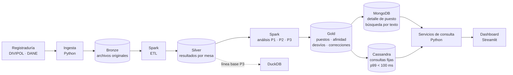

# Dos conteos, dos elecciones

**Plataforma de big data para analizar la concordancia del conteo y la correspondencia territorial del voto en Colombia 2026**

Proyecto aplicado del módulo de Big Data (M3) — Universidad Nacional de Colombia, Facultad de Ingeniería.

---

## Contenido

- [Descripción](#descripción)
- [Preguntas del proyecto](#preguntas-del-proyecto)
- [Datos](#datos)
- [Arquitectura](#arquitectura)
- [Organización en piezas](#organización-en-piezas)
- [Estructura del repositorio](#estructura-del-repositorio)
- [Instalación](#instalación)
- [Uso](#uso)
- [Entregas y cronograma](#entregas-y-cronograma)
- [Alcance y consideraciones](#alcance-y-consideraciones)
- [Equipo](#equipo)
- [Créditos y fuentes](#créditos-y-fuentes)

---

## Descripción

En 2026 el mismo electorado colombiano votó dos veces en menos de tres meses: por el Congreso (8 de marzo) y por la Presidencia en primera vuelta (31 de mayo). De cada elección, la Registraduría Nacional del Estado Civil publica los resultados mesa a mesa en dos versiones: el **preconteo** de los jurados y el **escrutinio** oficial.

Estos datos son públicos, pero en la práctica son difíciles de usar:

- suman cerca de **10 GB y del orden de 180 millones de registros**;
- vienen en formatos técnicos (**ancho fijo y CSV**);
- usan llaves que no coinciden entre fuentes y códigos territoriales distintos a los del DANE.

Este proyecto construye una plataforma de big data que integra esos resultados a nivel de **puesto de votación**, los analiza con procesamiento distribuido y los ofrece para consulta mediante bases de datos NoSQL y un dashboard.

---

## Preguntas del proyecto

| | Pregunta | Hipótesis |
|---|---|---|
| **P1** | ¿En qué medida la distribución territorial del voto presidencial de 2026 corresponde a la del voto al Senado del mismo electorado, y en qué territorios se aparta? | **H1:** existen listas al Senado y candidatos presidenciales que comparten base territorial, y zonas donde el voto presidencial se aparta de lo que predice el voto al Senado. |
| **P2** | ¿Las correcciones entre el preconteo y el escrutinio aumentan con la complejidad del tarjetón, y en qué territorios se concentran? | **H2:** las correcciones son más frecuentes y más grandes cuanto más complejo es el tarjetón (Presidencia → Cámara → Senado con voto preferente). |
| **P3** | ¿Desde qué volumen de datos y para qué operaciones el procesamiento distribuido y el almacenamiento NoSQL superan a una solución de una sola máquina? | **H3:** con el volumen de 2026, una sola máquina es competitiva por lotes; el procesamiento distribuido gana a partir de cierto volumen, y el almacenamiento precalculado mantiene una latencia estable. |

Los resultados de P2 sirven además como control de calidad para P1: si las correcciones del conteo son pequeñas frente a los desvíos encontrados, esos desvíos no se deben a errores de conteo.

---

## Datos

| Fuente | Contenido | Uso |
|---|---|---|
| Registraduría Nacional del Estado Civil | Resultados mesa a mesa de preconteo y escrutinio: Senado, Cámara y primera vuelta presidencial 2026 | Fuente principal |
| Registraduría Nacional del Estado Civil | Archivos básicos: DIVIPOL, partidos y candidatos | Llaves, nombres y potencial de votantes |
| DANE | Codificación DIVIPOLA | Normalización de los códigos territoriales |

**Unidad de análisis: el puesto de votación.** Solo el 63,4 % de los puestos conserva el mismo número de mesas entre elecciones, mientras que el 99,8 % conserva el mismo nombre. Por eso la mesa no garantiza el mismo electorado y el puesto sí. Para P1 solo se usan puestos con electorado estable: cambio de potencial menor al 5 %, con corridas adicionales al 2 % y al 10 %.

> Los datos crudos no se versionan en el repositorio por su tamaño. La carpeta `data/raw/` se llena con los scripts de descarga (ver [Uso](#uso)).

---

## Arquitectura

Sistema analítico de solo lectura, con procesamiento por lotes en capas *medallion* y una capa de consulta políglota. Como los resultados de 2026 ya no cambian, todo el cálculo costoso se hace por adelantado y cada consulta lee un resultado ya calculado.



| Capa | Tecnología | Función |
|---|---|---|
| Almacenamiento curado | Parquet en disco local | Fuente de verdad, particionada por elección, corporación y departamento |
| Procesamiento distribuido | Apache Spark (PySpark) | ETL, agregación a puesto y análisis de P1, P2 y P3 |
| NoSQL documental | MongoDB | Un documento por puesto con las dos elecciones y los dos conteos; búsqueda de candidatos |
| NoSQL columnar | Apache Cassandra | Una tabla por consulta frecuente; mesas del Senado y tablas por territorio |
| Línea base | DuckDB | Comparación con una solución de una sola máquina (P3) |
| Presentación | Streamlit | Dashboard con tablas, gráficos y descarga de resultados |

El detalle de la arquitectura, las decisiones de diseño (ADR) y los requisitos según ISO/IEC/IEEE 29148, ISO/IEC 25010 e ISO/IEC 25012 están en el notebook de la [Entrega 1](notebooks/Entrega01/).

---

## Organización en piezas

El proyecto se divide en **tres piezas**, como bloques de lego. Cada pieza va de punta a punta: procesa sus datos, los guarda en su motor, responde sus consultas y aporta su página del dashboard. Las piezas encajan a través de **conectores**, que definen qué información pasa de una a otra.

| | Pieza 1 — Plataforma de datos | Pieza 2 — Concordancia del conteo | Pieza 3 — Correspondencia del voto |
|---|---|---|---|
| **Pregunta** | P3 | P2 | P1 |
| **Tecnología** | Spark, Parquet, DuckDB | Spark + MongoDB | Spark + Cassandra |
| **Produce** | Datos curados por mesa y por puesto; puestos comparables | Correcciones por puesto y corporación | Matriz de afinidad y desvíos por puesto |

| Conector | Entre | Qué se pasa |
|---|---|---|
| **1** — Datos curados | Pieza 1 → piezas 2 y 3 | Esquema Parquet + generador de datos de prueba |
| **1b** — Correcciones | Pieza 2 → Pieza 3 | Dataset `correcciones_puesto` |
| **2** — Dashboard | Cada pieza → dashboard | Módulo de servicios y página de Streamlit |
| **3** — Mediciones | Cada pieza → informe de P3 | Tiempos en un formato común de CSV |

---

## Estructura del repositorio

```
M3-BigData/
├── data/
│   ├── raw/             # Archivos originales descargados (capa bronze, no versionados)
│   ├── interim/         # Datos intermedios del ETL (capa silver)
│   ├── processed/       # Datos curados y resultados de análisis (capa gold)
│   └── external/        # Datos de apoyo (p. ej. geo/)
├── docs/
│   ├── architecture/    # Documentación de arquitectura
│   ├── data_dictionary/ # Diccionario de datos
│   └── entregas/        # Documentos de cada entrega
├── notebooks/
│   ├── Entrega01/       # Entrega 1: entendimiento del negocio y arquitectura
│   └── drafts/          # Borradores de trabajo
├── observatorio/        # Dashboard en Streamlit
│   ├── app.py           # Punto de entrada del dashboard
│   ├── pages/           # Una página por entrega o pieza
│   ├── services/        # Servicios de consulta a MongoDB y Cassandra
│   └── assets/          # Recursos estáticos
├── results/
│   ├── figures/         # Gráficos generados
│   ├── metrics/         # Métricas y mediciones de rendimiento
│   └── tables/          # Tablas de resultados
├── scripts/             # Scripts de descarga, ETL y carga
├── requirements.txt     # Dependencias de Python
└── .python-version      # Versión de Python del proyecto (pyenv)
```

---

## Instalación

### Requisitos previos

| Herramienta | Versión | Instalación en macOS |
|---|---|---|
| Python | 3.12.11 (pyenv) | `pyenv install 3.12.11` |
| Java (para Spark) | 17 | `brew install openjdk@17` |
| Graphviz (diagramas) | — | `brew install graphviz` |
| MongoDB Community | 7 o superior | `brew tap mongodb/brew && brew install mongodb-community` |
| Apache Cassandra | 4 o superior | `brew install cassandra` |

En Linux, las mismas herramientas se instalan con el gestor de paquetes de la distribución (por ejemplo, `sudo apt install graphviz openjdk-17-jdk`).

### Entorno de Python

```bash
git clone <url-del-repositorio>
cd M3-BigData

pyenv local 3.12.11
python -m venv .venv
source .venv/bin/activate

python -m pip install --upgrade pip
pip install -r requirements.txt

python -m ipykernel install --user --name m3-bigdata --display-name "Python (M3 BigData)"
```

En VS Code o Jupyter, seleccione el kernel **Python (M3 BigData)**.

### Servicios de bases de datos

```bash
brew services start mongodb-community
brew services start cassandra
```

---

## Uso

### Notebooks

1. Active el entorno virtual: `source .venv/bin/activate`.
2. Abra el notebook de la entrega correspondiente en `notebooks/`.
3. Ejecute primero la celda de **configuración de diagramas** y luego el resto en orden.

### Dashboard

```bash
streamlit run observatorio/app.py
```

El dashboard se abre en `http://localhost:8501`.

---

## Entregas y cronograma

El proyecto dura **4 semanas**, del jueves 19 de noviembre al miércoles 16 de diciembre de 2026.

| Semana | Fechas | Hito |
|---|---|---|
| 1 | 19 – 25 nov | Entrega 1: entendimiento del negocio y arquitectura; conectores definidos |
| 2 | 26 nov – 2 dic | ETL completo; datos reales disponibles |
| 3 | 3 – 9 dic | Análisis con datos reales; integración de las tres piezas |
| 4 | 10 – 16 dic | Dashboard, mediciones de rendimiento, informes y entrega final |

| Entrega | Contenido | Estado |
|---|---|---|
| [Entrega 1](notebooks/Entrega01/) | Entendimiento del negocio, alcance, plan, arquitectura y requisitos | ✅ Entregada |
| Entregas siguientes | Datos, análisis, dashboard e informe final | ⏳ En curso |

---

## Alcance y consideraciones

**Incluye:** Senado (circunscripción nacional), Cámara (solo para P2) y primera vuelta presidencial de 2026; preconteo y escrutinio; puestos de votación en Colombia.

**No incluye:** voto en el exterior, circunscripciones especiales, segunda vuelta, cálculo de curules, predicción electoral, API REST para terceros, mapas ni despliegue en la nube.

**Consideraciones metodológicas y éticas:**

- **Falacia ecológica.** Los datos están agregados por puesto. Que una lista y un candidato sean fuertes en los mismos lugares no significa que las mismas personas hayan votado por los dos.
- **Neutralidad.** El proyecto describe patrones con datos públicos. No califica ninguna diferencia como fraude ni valora a partidos o candidatos; evaluar irregularidades corresponde a las autoridades electorales.
- **Datos personales.** Solo se procesan resultados agregados por mesa, sin información individual de votantes (Ley 1581 de 2012).

---

## Equipo

| Integrante | Documento |
|---|---|
| Alejandra Jaramillo Mejía | 1002652912 |
| Santiago Chaparro Suzunaga | 1002760592 |
| Brayan Sebastián Yepes García | 1015457884 |

**Profesor:** [Jorge E. Camargo, PhD](https://dis.unal.edu.co/~jecamargom/)
**Universidad Nacional de Colombia** — Facultad de Ingeniería

---

## Créditos y fuentes

- **Datos:** Registraduría Nacional del Estado Civil y DANE. Información pública reutilizada conforme a la Ley 1712 de 2014 (transparencia y acceso a la información pública).
- **Asistencia de IA:** el equipo usó Claude (Anthropic) como apoyo en la estructuración y redacción de la propuesta y en el diseño de la arquitectura. Las decisiones, los análisis y la validación del contenido son responsabilidad del equipo.
